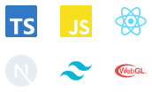
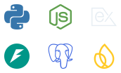
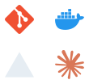

<h3>
  <picture>
    <source media="(prefers-color-scheme: dark)" srcset="./assets/name-dark.svg" />
    <source media="(prefers-color-scheme: light)" srcset="./assets/name-light.svg" />
    
  </picture>
  &nbsp;👋
</h3>

 

I'm a full-stack and creative frontend dev — learning by building, studying good craft across the web, and getting a little better with every project. Usually coding with music on.

 

<table>
  <tr>
    <td width="55%" valign="top">
      <h3>Working on</h3>
      

        <strong><a href="https://abssy.vercel.app/">Abyss</a></strong> — An open-source collection of copy-paste React components I keep adding to whenever I build something worth reusing.
      

      

        
        
      

      <picture>
        <source media="(prefers-color-scheme: dark)" srcset="./assets/abyss-stack-dark.svg" />
        <source media="(prefers-color-scheme: light)" srcset="./assets/abyss-stack-light.svg" />
        
      </picture>
    </td>
    <td width="45%" valign="top">
      <h3>How I work</h3>
      

        🎧 Headphones on, building things end to end.  
        ✦ Studying great interfaces and motion across the web for inspiration.  
        ⚡ Using AI tools to move faster while owning the design and code.
      

    </td>
  </tr>
</table>

 

### Stack

<table>
  <tr>
    <th align="center">Frontend</th>
    <th align="center">Backend & Data</th>
    <th align="center">Tools</th>
  </tr>
  <tr>
    <td align="center">
      <picture>
        <source media="(prefers-color-scheme: dark)" srcset="./assets/stack-frontend-dark.svg" />
        <source media="(prefers-color-scheme: light)" srcset="./assets/stack-frontend-light.svg" />
        
      </picture>
    </td>
    <td align="center">
      <picture>
        <source media="(prefers-color-scheme: dark)" srcset="./assets/stack-backend-dark.svg" />
        <source media="(prefers-color-scheme: light)" srcset="./assets/stack-backend-light.svg" />
        
      </picture>
    </td>
    <td align="center">
      <picture>
        <source media="(prefers-color-scheme: dark)" srcset="./assets/stack-tools-dark.svg" />
        <source media="(prefers-color-scheme: light)" srcset="./assets/stack-tools-light.svg" />
        
      </picture>
    </td>
  </tr>
</table>

 

### Connect

