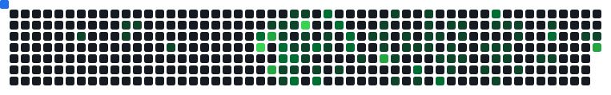

<picture>
  <source media="(prefers-color-scheme: dark)" srcset="./assets/name-dark.svg" />
  <source media="(prefers-color-scheme: light)" srcset="./assets/name-light.svg" />
  
</picture>

 

 

 

#### 👋 I'm a full-stack and creative frontend dev, learning by building, studying good craft across the web, and getting better with every project. Usually coding with music on.

---

### 🛠️ Working on

- **Abyss is an open-source collection of 23 copy-paste React components I keep adding to whenever I build something worth reusing.**
- **Covers interactive UI pieces, motion primitives, and WebGL visuals you can drop straight into existing apps.**
- **Links:** [Live Site](https://abssy.vercel.app/) · [GitHub](https://github.com/DShivam9/Abyss)
- **Built with:** <picture><source media="(prefers-color-scheme: dark)" srcset="./assets/abyss-stack-dark.svg" /><source media="(prefers-color-scheme: light)" srcset="./assets/abyss-stack-light.svg" /></picture>

 

### 🧰 Stack

 

 

 

 

 

 

<picture>
  <source media="(prefers-color-scheme: dark)" srcset="./assets/contributions-dark.svg" />
  <source media="(prefers-color-scheme: light)" srcset="./assets/contributions-light.svg" />
  
</picture>

 

### 📫 Connect

 

headphones on, figuring things out one build at a time.

