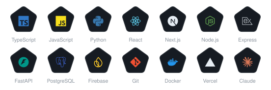

<picture>
  <source media="(prefers-color-scheme: dark)" srcset="./assets/name-dark.svg" />
  <source media="(prefers-color-scheme: light)" srcset="./assets/name-light.svg" />
  
</picture>

 

 

> I'm a full-stack and creative frontend dev — learning by building, studying good craft across the web, and getting a little better with every project. Usually coding with music on.

 

### Working on

> **[Abyss](https://abssy.vercel.app/)** · [GitHub](https://github.com/DShivam9/Abyss)  
> An open-source collection of copy-paste React components I keep adding to whenever I build something worth reusing.

<picture>
  <source media="(prefers-color-scheme: dark)" srcset="./assets/abyss-stack-dark.svg" />
  <source media="(prefers-color-scheme: light)" srcset="./assets/abyss-stack-light.svg" />
  
</picture>

 

### Stack

<picture>
  <source media="(prefers-color-scheme: dark)" srcset="./assets/stack-dark.svg" />
  <source media="(prefers-color-scheme: light)" srcset="./assets/stack-light.svg" />
  
</picture>

 

### Connect

